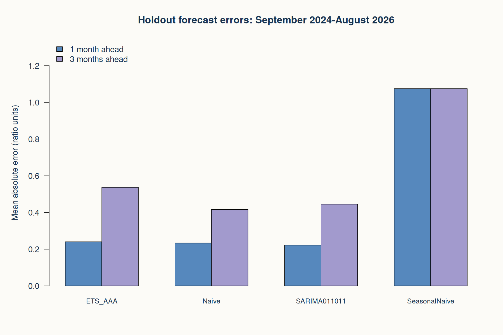
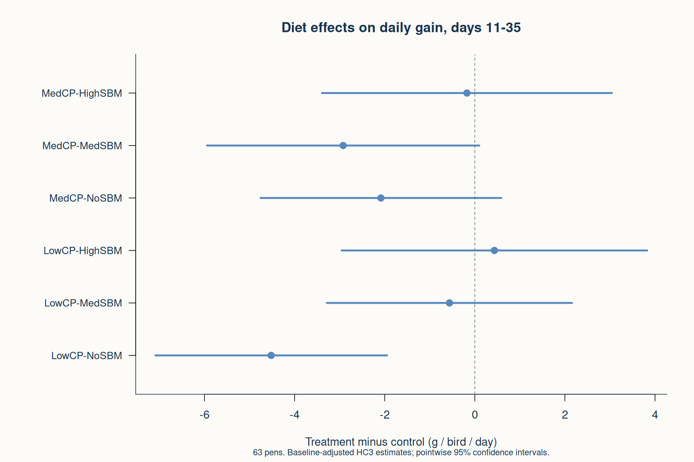

# Poultry Nutrition Evidence

**Building the Future of African Livestock | Side Quests 11–14**

Executed R analyses of poultry feed purchasing power and randomized dietary-treatment effects, with independent Python verification and tested data-governance controls.

| Evidence | Result |
|---|---|
| USDA monthly series | 200 complete months, January 2010–August 2026 |
| Feeding trial | 63 pens, seven diets, nine pens per diet |
| Forecast evaluation | Selected ETS/SARIMA models did not beat the carry-forward baseline on holdout MAE |
| Primary FCR contrasts | No significant diet-versus-control differences after Holm correction; not equivalence |
| LowCP-NoSBM daily gain | −4.52 g/bird/day versus CT; 95% CI −7.09 to −1.95 |
| Verification | 13 internal control tests and 14 independent Python checks passed |

## Start here

- [Executed R script](Poultry_Analysis.R)
- [Results and interpretation](Results_Summary.md)
- [Full report](Poultry_Analysis_Report.html) (download and open in a browser)
- [All 12 charts, PNG and PDF](outputs/figures/)
- [24 results tables](outputs/tables/)
- [Independent Python verification](verify_results.py)
- [Governance and audit scope](governance/governance.md)
- [Risk register](governance/risk_register.csv)
- [Publication evidence map](Four_Day_Evidence_Map.md)

**Scientific boundaries:** The USDA ratio is an economic purchasing-power measure, not feed cost per bird or biological FCR. The trial estimates whole-diet effects in Canadian research pens. Public block IDs are missing. The selected ETS model retains residual dependence. Neither analysis establishes African farm effect sizes, equivalence, autonomous deployment readiness or independent compliance certification.

## Run the analysis

1. Extract the complete ZIP. Keep its folder structure.
2. In R/RStudio set the working directory to this project folder.
3. Install dependencies if necessary:
   `install.packages(c("readxl", "forecast", "urca", "sandwich", "digest", "nlme", "jsonlite"))`
4. Execute `source("Poultry_Analysis.R")` or `Rscript Poultry_Analysis.R`.
5. Optional independent verification: `python verify_results.py` (numpy, pandas, scipy, openpyxl, Pillow).
6. Regenerate the reader report: `python build_report.py` (pandas).

`Poultry_Analysis.R` is the actual executed analysis, with numbered objectives, functions, validation flags and exports. It stops on data-integrity failures. It uses bundled snapshots rather than silently downloading changed records. The package versions and R version actually used are in `outputs/logs/`. Installation with newer packages can change numerical results; use the recorded versions for close replication. No claim of a fully containerized environment is made.

## Sources

- USDA ERS Feed Grains Yearbook Table 15, workbook dated 13 October 2026: https://www.ers.usda.gov/data-products/feed-grains-database/feed-grains-yearbook-tables
- USDA definitions: https://www.ers.usda.gov/data-products/feed-grains-database/documentation
- Trial article: https://doi.org/10.1016/j.animal.2026.101771
- Deposited data: https://doi.org/10.57745/1ZCQMN
- Governance reference: NIST AI RMF 1.0, https://doi.org/10.6028/NIST.AI.100-1. This voluntary reference organizes the documentation; the project does not claim certification or full framework conformity.

The broiler-feed ratio is pounds of broiler-grower feed equal in value to one pound of live broiler. It is not feed conversion ratio, feed cost per bird, net margin or an isolated feed-price series.

## Analysis flow

| Section | Purpose | Evidence |
|---|---|---|
| 00-02 | Import original sources, verify checksums, reshape calendar months, validate pens | Source manifest, reconciliation, missingness tables |
| 03 | Assess stationarity, seasonal pattern and dependence | ADF/KPSS, decomposition, ACF/PACF |
| 04-05 | Compare ARMA/ARIMA/SARIMA/ETS against two baselines | Origin-level predictions, development selection, holdout metrics, residual checks |
| 06 | Estimate treatment effects and uncertainty | Baseline-adjusted and unadjusted estimates, HC3/conventional SEs, Holm p values |
| 07 | Connect pens to phases and explore factorial interactions | 126 pen-phase records, mixed models, 54-pen factorial analysis |
| 08 | Check sensitivity and influential pens | Leave-one-pen-out estimates and influence diagnostics |
| 09 | Produce authentic R figures | 12 PNG and PDF figure pairs |
| 10 | Challenge integrity controls with deliberately invalid inputs | Fault-injection evidence and output hashes |

## Design decisions and boundaries

**Forecasting.** Initial training: January 2010-December 2017. Development targets: January 2018-August 2024 (3-month forecasts start March 2018). Holdout targets: September 2024-August 2026, 24 targets per horizon. Fifteen prespecified candidate specifications. Select separately for 1 and 3 months by development MAE, then RMSE/name as deterministic tiebreakers. Refit on expanding histories without using future observations. The selected model is not switched after seeing holdout performance. A two-model equal-weight combination is a sensitivity analysis, not a new post-hoc winner. Failed candidates are recorded and excluded from selection when their development coverage is incomplete. AICc/BIC are supplementary; differenced model information criteria are not treated as universal cross-family rankings.

This is a historical backtest using one released data vintage, not a simulated real-time release archive. Final observations may be revised. Three-month forecast errors overlap; no independent-error significance test is claimed. Nominal prediction interval coverage based on 24 test months is imprecise. Latest forecasts are explicitly conditional on data ending August 2026.

**Causal inference.** Randomized trial in Quebec, Canada, October-November 2022; 63 pens, nine per dietary treatment, 47 chicks initially per pen. Treatment period days 11-35. Primary outcome: FCR over days 11-35. Secondary: ADG over the same period. Treatment minus control contrasts represent the entire assigned ration. Protein sources and other formulation features change together, so isolated crude-protein or amino-acid effects are not identified. Baseline weight is centered across all pens and used only as a pretreatment precision covariate. No feed-intake mediator adjustment. Holm corrections apply separately to six CT contrasts within each endpoint and model specification. Confidence intervals are pointwise, not familywise simultaneous intervals. The adjusted HC3 FCR analysis is designated primary for this reanalysis; this was not a prospective preregistration.

The paper's block identifiers are absent from the public table. HC3 does not recreate block adjustment. Pen-level independent-error inference is therefore an approximation to the published blocked design. No exact blocked randomization test is claimed. The repository's BW labels D10/D22 differ from paper phase-boundary labels D11/D23; deposited names are preserved and the mismatch is disclosed. Mortality percentages are descriptive only. Ancillary body-composition, litter and balance files have missing values and are excluded from the complete-case performance analysis. No imputation or selective pen exclusion is used.

**Longitudinal analysis.** Two measured treatment phases per pen, not daily records. Random-intercept mixed models allow phase-specific residual variance, with ML likelihood-ratio tests for treatment-by-phase interaction and REML coefficient estimates. Factorial CP-by-SBM analysis excludes CT by design and uses the 54 factorial pens. These are supporting, exploratory analyses.

**Methods deliberately not forced.** Matching and propensity-score IPTW are unnecessary for the randomized treatment comparison. The public data do not supply a defensible instrumental variable. No invented instrument, reconstructed blocks, fabricated daily measures, mortality-cause claims or African cost savings appear in this project.

## Governance and use

Read `governance/governance.md`, the risk register, tested controls and independent verification together. These are internal analytical controls, not an independent audit, a privacy-law opinion, a cybersecurity penetration test or approval for autonomous feeding/procurement. There is no deployed AI service, LLM agent or production access-control layer in this project. Statistical forecast models are evaluated as decision-support components of a possible future system.

The strongest portfolio evidence is the traceable chain from data to validated result, including unfavorable results, model failures and untested controls. Proposed deployment controls are clearly labeled rather than presented as operating controls.
